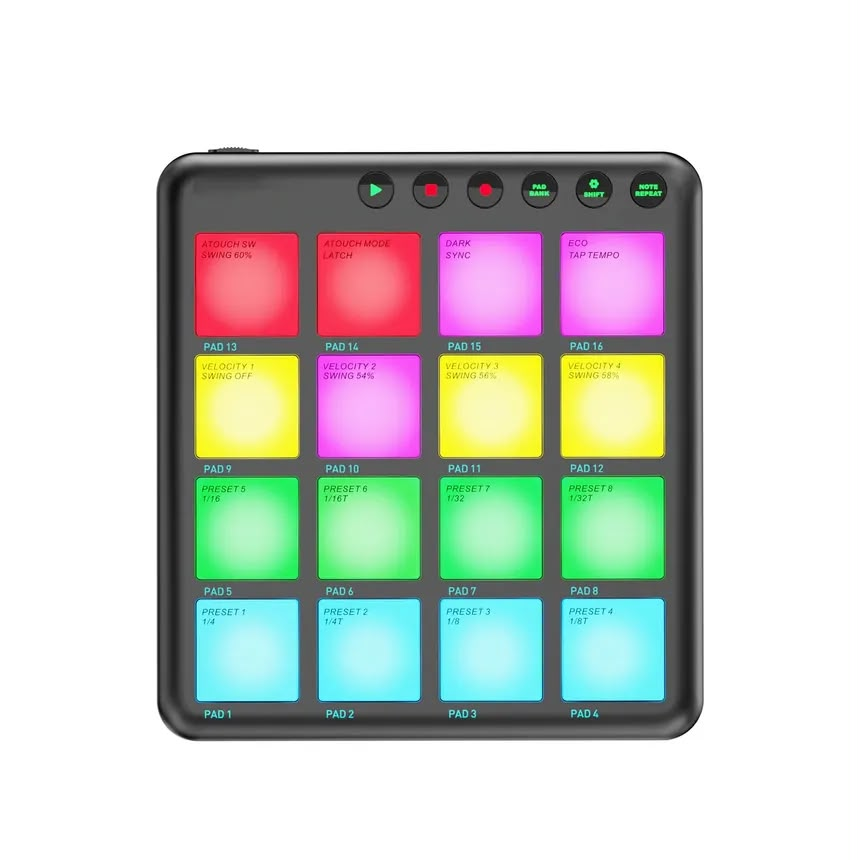

# Project-4
MIDI sound mixer (High Forever-Petite Meller)

# p5.js links 
https://editor.p5js.org/mtar347/sketches/6EUpKsutn

https://editor.p5js.org/JJJiaYE/sketches/lrYCAEFds

PROJECT HERE -----> https://editor.p5js.org/S9R7L/sketches/SA2YTRazN

# Inspiration 
The main idea was a MIDI board that would play the song and cut out certain parts to hear certain sections of the song chosen, functionality was the main focus when making the piece.

# Technical process

The main issue was adapting a button to allow it to play the 5 sound files at the same time and implement a mute function for the set up with took trial and error

<img src "

# References 

https://p5js.org/reference/p5.MediaElement/stop/

https://www.p5sound.com/files-playback/index.html

https://editor.p5js.org/2sman/sketches/rJdChI22-

https://editor.p5js.org/mrbombmusic/sketches/B1fM_hvJG
